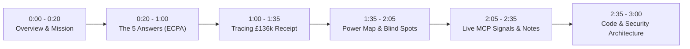

# Three-Minute Walkthrough Video Script
## FlytBase Questathon: Live Account Intelligence CRM

**Target Duration:** Exactly 3 minutes (180 seconds)  
**Host / Presenter:** Account Manager / Lead Engineer  
**Recording Requirement:** Shared on Google Drive as "Anyone with the link can view". **NEVER display the API token on screen.**

---

### Timing & Scene Breakdown

---

### [0:00 – 0:20] Scene 1: Introduction & Executive Purpose
- **Screen:** Open browser at the live hosted CRM URL (e.g. `https://flytbase-challenge.vercel.app`) in an Incognito/Private window. Show the clean Executive Overview dashboard without any login gate.
- **Spoken Script:**
  > *"Welcome. This is Account Intelligence for FlytBase — a manager-ready Monday CRM built for the Questathon. It connects live to the Questathon MCP to manage two enterprise accounts: Eastern Counties Police Alliance and Aldermoor Industrial Group. Executed contracts are backed by verified order forms, while morning discovery progression estimates are strictly isolated from committed revenue, and unbacked champion claims are shown apart."*

---

### [0:20 – 1:00] Scene 2: The Five Answers for Eastern Counties Police Alliance
- **Screen:** Click on **"Eastern Counties Police Alliance"** (or use the sidebar tabs).
- **Spoken Script:**
  > *"Here are the five management answers for ECPA on Monday morning:*
  > 1. ***What is the book worth?*** *Signed contract baseline is £350,000 verified by order forms. Morning discovery qualified estimate is £731,440 across four deals, with flight logs and benchmarks serving as operational blocker evidence, not pricing proofs. The nominal £2.3 million potential is shown separately, isolating £1.57 million of uncommitted framework ambitions.*
  > 2. ***Who holds the power?*** *Rhys Calder is our ally and programme lead, but he cannot approve spending — each force signs its own call-off. Ewan Brooks holds the budget for Metro Central; Fatima Osei holds the compliance gate for Tarn Valley.*
  > 3. ***What do we do first?*** *Our Monday 9am action plan ranks delivering the engineering data-flow pack to Fatima Osei first (Score 95/100) to unlock £142,302.*
  > 4. ***What is about to go wrong?*** *Metro Central's autumn finance window closes in 8 moves. If Ewan doesn't get the helicopter cost comparison in time, capital funding is lost for FY27.*
  > 5. ***What do we still not know?*** *We don't know the per-force dock serial locations because install sheets were retained by the field team."*

---

### [1:00 – 1:35] Scene 3: Tracing One Number to Its Source Receipt
- **Screen:** Navigate to **"Book with Receipts"**. Click on the supported value **"£136,361"** next to `a_renewal`.
- **Action:** The **Evidence & Audit Receipt Modal** slides open.
- **Spoken Script:**
  > *"Let's trace a number to where it came from. The renewal is nominal £350,000, but our morning qualified discovery value is £136,361. Why?*
  > *Clicking into the receipt reveals the exact formula: our signed annual contract is verified at £350,000 by order form `doc_a_contract`, while our qualification model values the immediate operational renewal at £136,361 based on flight logs in `flight_log_force_month.csv` and fact `km_usage_1` proving 14 of 18 docks flew operationally last month in Westmere. We distinguish signed contract cash from discovery qualification, never confusing flight logs for pricing calculations, and we flag the remaining £213,639 as pending blocker clearance."*

---

### [1:35 – 2:05] Scene 4: Power Map & Blind Spot Verification
- **Screen:** Navigate to **"Power Map"**, then **"Blind Spots"**.
- **Spoken Script:**
  > *"Moving to the Power Map: notice how roles are labeled. Rhys Calder is marked as Alliance Programme Lead and Champion, but Budget Payer is explicitly 'No' with citation `rc_funding_2`, because each force funds call-offs from its own budget. In Aldermoor, Group Finance Controller Nadia Rahman is flagged as 'Never Met' — renewal signing authority remains unconfirmed since shared mailbox inquiries went unanswered.*
  > *On the Blind Spots tab, we distinguish 'Confirmed not available' from 'Unknown', giving the account manager the exact question to ask on Monday."*

---

### [2:05 – 2:35] Scene 5: Live Events Ingestion & Writing Notes Back via MCP
- **Screen:** Click **"Live Events Feed"**. Show the active "Auto-Polling Active (65s)" telemetry badge, then click **"Poll get_signals Now"** (top right). Then switch to **"Notes & Tasks (MCP)"**.
- **Action:** Show the live sync status. In Notes & Tasks, fill in:
  - Account: `Account A`
  - Kind: `next_step`
  - Text: `Dispatching data-flow pack to Fatima Osei for DPIA review.`
  - Click **"Preview & Confirm Dispatch"**, then confirm.
- **Spoken Script:**
  > *"The system stays live automatically through background polling every 65 seconds — and supports instant manual sync — while strictly enforcing the distributed 1-call-per-minute rate limit lock. Under Notes & Tasks, writes are tracked with explicit sync status, distinguishing confirmed remote writes from locally saved notes, with cold-start persistence across restarts."*

---

### [2:35 – 3:00] Scene 6: Code Architecture & Security
- **Screen:** Switch briefly to VS Code / terminal.
- **Highlight:**
  - `src/lib/mcp.ts`: Centralized JSON-RPC client with token masking and rate limit tracking.
  - `src/lib/data-store.ts`: Deterministic relational normalization.
  - `.env.local` in `.gitignore`: Zero token leaks.
- **Spoken Script:**
  > *"Under the hood: Next.js 14 App Router, TypeScript, and Tailwind CSS. The API token `AQ_TOKEN` lives strictly on the server in serverless API routes — never in browser JavaScript, never in Git history, and never in client state. The app builds cleanly, runs serverless without my laptop, and opens in any private browser window without authentication. Thank you."*
